# Weather Decision Gym (가칭)
### 날씨로 자동 채점되는 RL 환경·평가셋 — 미국 RL Eval·데이터 회사가 돈 내고 쓸 서비스

> AttentionX 해커톤 · 주제: "미국 RL Eval·데이터 회사가 돈 내고 쓸 서비스"
> 작성일: 2026-10-24 · 팀 공유용 리서치 & IR 덱 초안
> 다이어그램은 Mermaid로 작성되어 GitHub·Notion·Obsidian·VS Code(Mermaid 확장)에서 바로 렌더링됩니다.

---

## 0. TL;DR (30초 요약)

- **고객은 농민이 아니라 RL 데이터 회사·프론티어 랩이다.** Mercor·Surge·Handshake는 각각 연 $1B 이상을 벌고, Anthropic은 RL 환경에 1년간 $1B 이상 지출을 논의했다고 보도됨.
- 이들에게 부족한 건 사람이 아니라 **"자동 채점되고, 오염되지 않고, 매일 새로 생기는 과제"** 다. 수학·코드 밖에서는 이런 과제가 거의 없다.
- **날씨는 완벽한 검증 가능 보상(verifiable reward) 원천이다.** 결과가 반드시, 수치로, 매시간, 격자점마다 확정된다. 미래 사건이라 학습 데이터 오염이 불가능하다.
- 원천 예보는 무료가 됐다(ECMWF AIFS/IFS 2025.10부터 전면 개방, CC-BY 상업 이용 가능). 승부처는 그 위의 **로컬 관측 + 도메인 손실 함수 + 유통 채널**이다 — 우리 경우 유통 채널 = RL 데이터 회사.
- 제품: 공개 예보 + 로컬 관측 + 농업·에너지·보험 의사결정 맥락으로 **에이전트 과제를 매일 자동 생성**하고, 실제 날씨가 확정되면 **확률 점수(CRPS/Brier) + 결정의 금전 가치**로 채점하는 RL 환경 피드 & 비공개 평가셋.
- Salient Predictions의 "확률 S2S 예보 → 산업별 의사결정" 모델을 **"확률 의사결정 과제 → AI 학습·평가"** 로 뒤집은 것.

---

## 1. Problem — 구매자가 겪는 문제

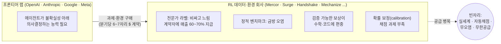

| 문제 | 근거 |
|---|---|
| RL 환경은 랩들의 새로운 병목 | 대형 랩 모두 내부 구축 중이지만 너무 복잡해 외부 공급사도 탐색 (a16z, TechCrunch) |
| 비싸다 | 과제당 대체로 **$200~$2,000**, 드물게 $20,000. 계약은 **분기당 6~7자리 $**, 독점 계약은 **4~5배** (Epoch AI) |
| 전문가 의존 구조 | Mercor 총매출의 60~70%가 계약자 지급 → 마진 구조 약함 |
| 확률 보정 문제 | 정답/오답 보상만으로는 RLVR이 보정을 오히려 악화시킬 수 있음 → Brier 등 proper scoring 보상 연구로 이동 중 (RLCR 등) |
| 오염 | 정적 데이터셋은 공개 즉시 다음 세대 사전학습에 섞임. ForecastBench·Prophet Arena 같은 "미래 사건" 벤치마크가 뜨는 이유 |

---

## 2. Solution — Weather Decision Gym

**한 줄 정의:** 공개 AI 기상 예보 위에 로컬 관측과 산업 의사결정 맥락을 얹어, 매일 수천 개의 에이전트 과제를 자동 생성하고, 날씨가 확정되면 자동 채점하는 RL 환경 & 평가셋.

### 2-1. 에피소드 한 개의 생애주기

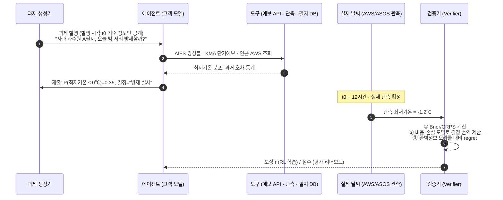

### 2-2. 과제 패밀리 = 전제에서 정의한 4개 시장

| 패밀리 | 해상도/리드타임 | 과제 예시 | 정답 확정 | 채점 |
|---|---|---|---|---|
| **① 초국지 다운스케일링** | 필지·1km 이하 | "A필지 내일 최저기온 분포를 제시하라" (격자 예보 → 필지 보정) | 1일 | 인근 AWS 관측 대비 CRPS |
| **② 나우캐스팅** | 0~6시간 | "지금 농약 살포 vs 3시간 연기" / "수확 강행 vs 대기" | 1~6시간 | 강수 확정 후 결정 손익 |
| **③ S2S·계절** | 2~6주 | "3주 뒤 파종 시기 결정", "가스 조달 헤지 비율" (Salient의 영역) | 2~6주 | 3분위 확률 Brier + 헤지 손익 |
| **④ 의사결정·가격** | 다양 | "서리 지수보험 보험료 산정", "관개 스케줄", "병해충 방제 시기" | 다양 | 보험수리 손실 함수, 수확량 모델 |

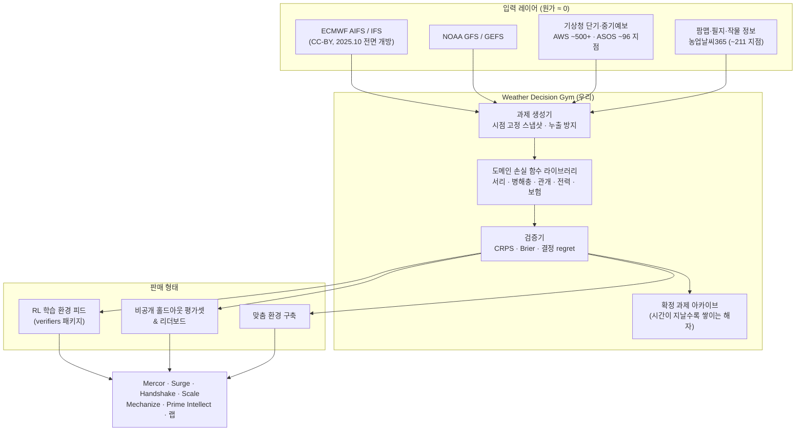

### 2-3. 채점 예시 — 서리 방제 (비용-손실 모델, 예시 수치)

기상 의사결정 분야의 고전인 **비용-손실(cost-loss) 모델**을 보상 함수로 씁니다.

- 방제 비용 **C = 30만 원/ha**, 서리 피해 손실 **L = 300만 원/ha** (가정)
- 최적 규칙: **P(서리) > C/L = 0.10 이면 방제**
- 에이전트 결정의 regret = 에이전트 비용 − 완벽정보 오라클 비용

| 실제 결과 | 에이전트: 방제 | 에이전트: 미방제 | 오라클 |
|---|---|---|---|
| 서리 발생 | 비용 30 → regret **0** | 비용 300 → regret **270** | 30 |
| 서리 없음 | 비용 30 → regret **30** | 비용 0 → regret **0** | 0 |

→ 보상 = −regret (정규화) + λ·(−Brier). **확률을 잘 맞히는 능력**과 **그 확률로 돈이 되는 결정을 하는 능력**을 동시에 학습시킵니다. 정답/오답만 주는 보상이 보정을 망치는 문제를 proper scoring으로 해결하는 최신 연구 흐름과도 일치합니다.

---

## 3. Why Weather? — 날씨가 RL 보상으로 특별한 이유

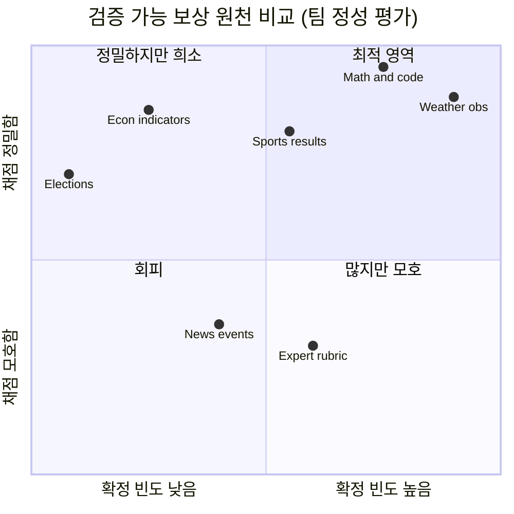

| 속성 | 날씨 | 뉴스·사건 예측 (Lightning Rod, Prophet Arena) | 수학·코드 |
|---|---|---|---|
| 결과 확정 | ✅ 반드시, 수치로 | ⚠️ 모호·지연·취소 가능 | ✅ 즉시 |
| 과제 공급량 | ✅ 지점 × 변수 × 리드타임 × 매시간 | ⚠️ 하루 수십~수백 건 | ✅ 많음 |
| 오염 저항 | ✅ 미래 사건 | ✅ 미래 사건 | ❌ 정적 → 오염 |
| 확률 채점 표준 | ✅ CRPS/Brier가 업계 표준 (ECMWF가 fair CRPS로 AIFS 앙상블 학습) | ✅ Brier | ❌ 주로 정답/오답 |
| 금전 가치 연결 | ✅ 농업·에너지·보험 손실 함수 | ⚠️ 예측시장 수익 정도 | ❌ |
| 도구 사용 에이전트 | ✅ API·격자·관측 조회 필수 | ✅ 검색 | ⚠️ |

---

## 4. Why Now

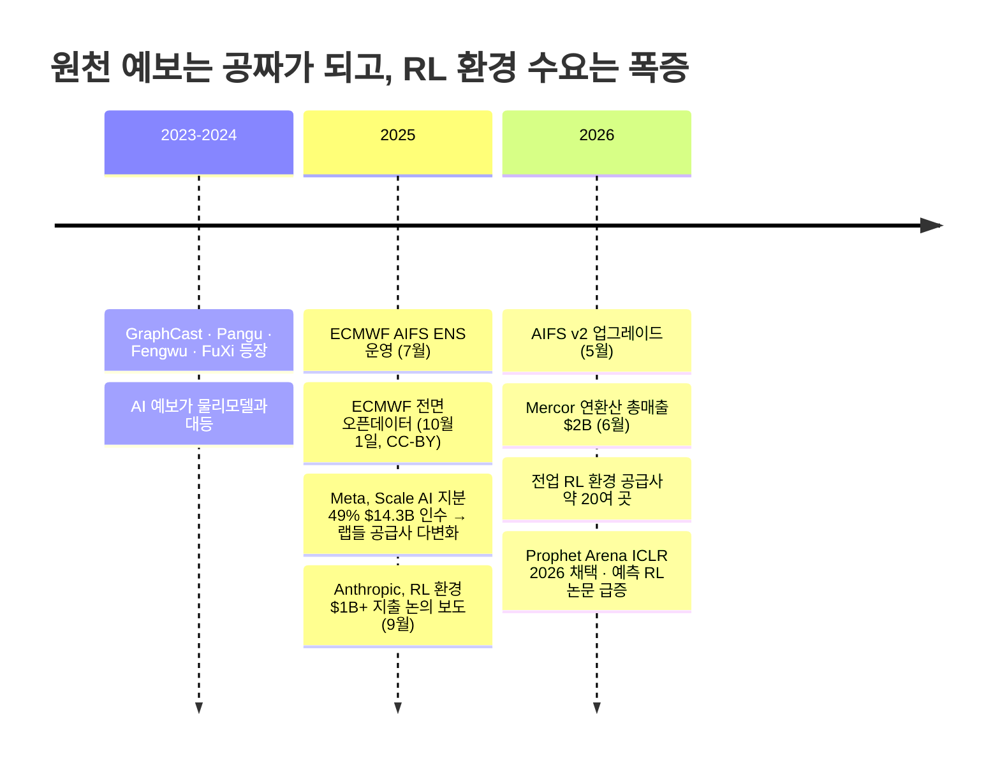

세 가지 흐름이 동시에 진행 중입니다.
1. **원천 예보 가격 → 0**: ECMWF가 IFS·AIFS를 원 해상도로 무료 개방하고 상업 이용을 허용(CC-BY 4.0, 출처 표기 필요). 빅테크도 모델을 공개.
2. **RL 환경 = 새 데이터 예산**: 라벨링 → RL 환경으로 예산 이동. Surge도 RL 환경 전담팀을 만듦.
3. **예측(forecasting) RL이 연구 최전선**: Outcome-based RL, Future-as-Label(Qwen3-32B Brier 27% 개선), ForecastBench(LLM과 슈퍼포캐스터 격차가 2026년 중 해소될 것으로 전망), Prophet Arena.

---

## 5. Market

### 5-1. 구매자 규모 (2026 추정치, 대부분 총매출 기준)

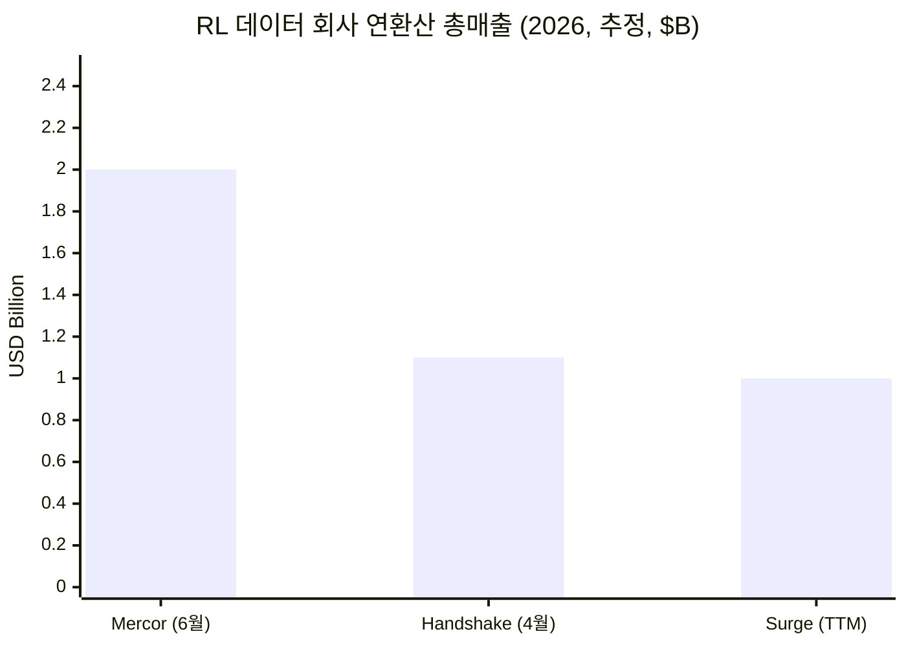

| 회사 | 규모 | 기업가치 | 우리에게 의미 |
|---|---|---|---|
| Mercor | 연환산 총매출 $2B+ (2026.6), 연초 대비 2배 | $10B (2025.10), $20B 협상 보도 | 전문가 과제 단가 높음 → 자동 생성 과제로 원가 절감 니즈. 2026.3 데이터 유출로 Meta가 작업 중단 |
| Surge AI | 매출 $1B+ (TTM), 직원 ~110명, 외부 투자 없음 | $15B 투자 유치 보도 | RL 환경 전담팀 보유 → 도메인 환경 소싱 파트너 |
| Handshake AI | 총매출 ~$1.1B, 순매출 ~$450M (Sacra, 2026.4), 전년 대비 +349% | — | 박사급 네트워크 1,800만 명. 기상·농학 박사를 검수자로 활용 가능 |
| Scale AI | — | $29B+ (Meta 49% 인수 후) | OpenAI·DeepMind가 의존도 축소 보도 → 랩 직접 판매 기회 |
| Mechanize | 시드 $9.1M (2026.4) | — | "소수의 견고한 환경" 전략, Anthropic 협업 보도 |
| Prime Intellect | Environments Hub ("RL 환경의 Hugging Face") | — | 무료 배포 채널 + 신뢰 형성 |

### 5-2. TAM / SAM / SOM (가정 기반, 발표 전 팀 검증 필요)

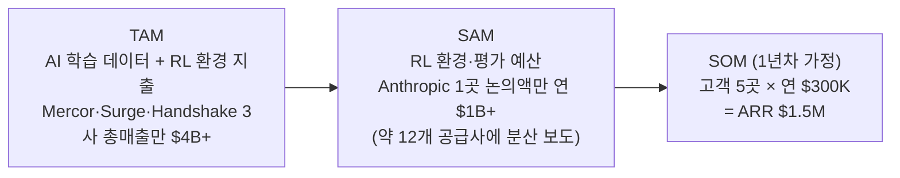

> 2차 시장: 같은 엔진(과제 생성 + 손실 함수 + 학습된 에이전트)을 Salient식 수직 B2B(농업·에너지·보험 의사결정 SaaS)로 확장.

---

## 6. Competition & Benchmarks

### 6-1. 포지셔닝 맵

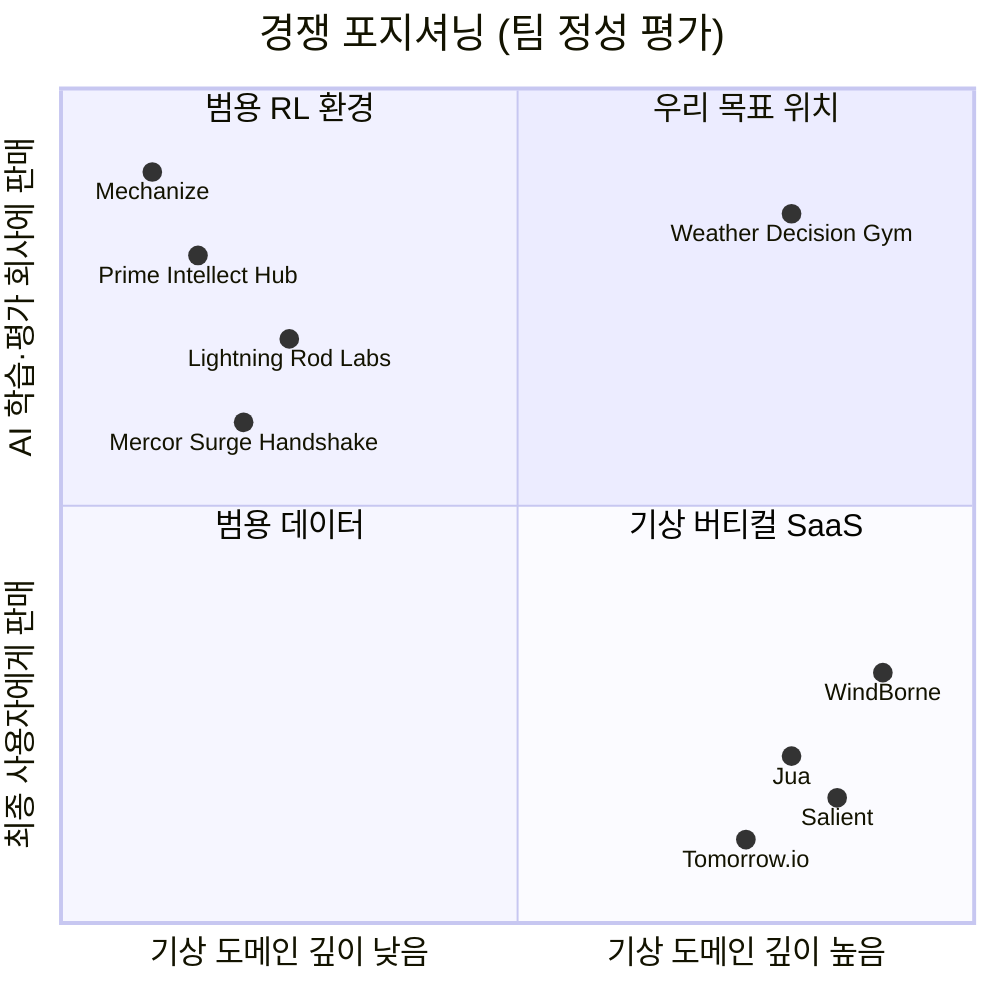

### 6-2. 벤치마크 상세

**A. 원천 예보·기상 AI 회사 (최종 사용자에게 판매)**

| 회사 | 국가 | 사업 | 최근 동향 | 우리가 배울 점 |
|---|---|---|---|---|
| **Salient Predictions** | 미국 | S2S(2~52주) 확률 예보 API. 구독 SaaS + DaaS + 컨설팅 + 정부 계약 | 누적 약 $10~12M (출처별로 다름), 2025 NOAA SBIR(센트럴밸리 S2S 수자원) | **확률·보정 중심** 메시지, 4가지 수익원 구조, 정부 과제로 초기 매출 |
| **Tomorrow.io** | 미국 | 예보 + 자체 위성 DeepSky | 시리즈 F 총 $210M (2026) | 원천 관측을 직접 확보하는 쪽으로 해자 이동 |
| **WindBorne Systems** | 미국 | 자체 기상 풍선 관측 + AI 모델 | 시리즈 B $37M (2026.8), 기업가치 $250M | 관측 데이터가 희소 자산 |
| **Jua** | 스위스 | EPT-2 지구 시뮬레이션 모델, 에너지 트레이더 대상 | 시리즈 A €10M, 누적 $27M | 버티컬 하나(에너지 트레이딩)에 집중 |
| **Silurian** | 미국 | 날씨 파운데이션 모델 | $6M (2026.4) | — |
| **Brightband** | 미국 | 오픈 AI 기상 모델 | 누적 ~$10M | 오픈 전략 |
| **Techwind (Fengwu)** | 중국 | 상하이 AI Lab의 Fengwu 상용화 | Fengwu: GraphCast 대비 평가 변수의 ~80%에서 우세 주장, 태풍 상륙 5일 전 30km 이내 | 국가 주도 + 산업 응용 분리 구조. 태풍 **강도** 예측은 아직 약점 |
| Huawei Pangu · Fudan FuXi | 중국 | 빅테크·학계 모델 | — | 원천 모델은 범용재가 됨 |

**B. RL 환경·데이터 회사 (구매자이자 경쟁자)** → 5-1 표 참조

**C. 가장 가까운 직접 벤치마크: 예측(forecasting) 기반 학습 데이터**

| 대상 | 내용 | 우리와의 차이 |
|---|---|---|
| **Lightning Rod Labs** | 비정형 문서를 사람 주석 없이 예측 학습 데이터로 변환. Foresight-32B가 ForecastBench·ProphetArena 1위라고 주장(자사 자료). 금융·헬스케어·물류·국방 대상 | 뉴스·사건 기반 → 결과 확정이 희소하고 모호. **우리는 수치·고빈도·금전 가치** |
| **Prophet Arena** (시카고대 외, ICLR 2026) | Kalshi·Polymarket 질문으로 LLM 실시간 예측 평가. 병목: 사건 기억 오류, 데이터 출처 오해, 정보 취합 속도 | 평가 전용. 학습 환경으로 판매하지 않음 |
| **ForecastBench** (FRI) | 라운드당 250문항. 슈퍼포캐스터 Brier 0.081 vs 최고 LLM 0.101 (2025 말), 2026.6 동등 수준 도달 전망 | 사건 예측. 날씨 과제 없음 |
| **WeatherBench 2** (Google 외) | AI 기상 모델 평가 프레임워크, 데이터 공개 | **모델** 평가용이지 **에이전트·의사결정** 평가용이 아님 → 그대로 빈자리 |

---

## 7. Business Model — Salient 모델의 변형

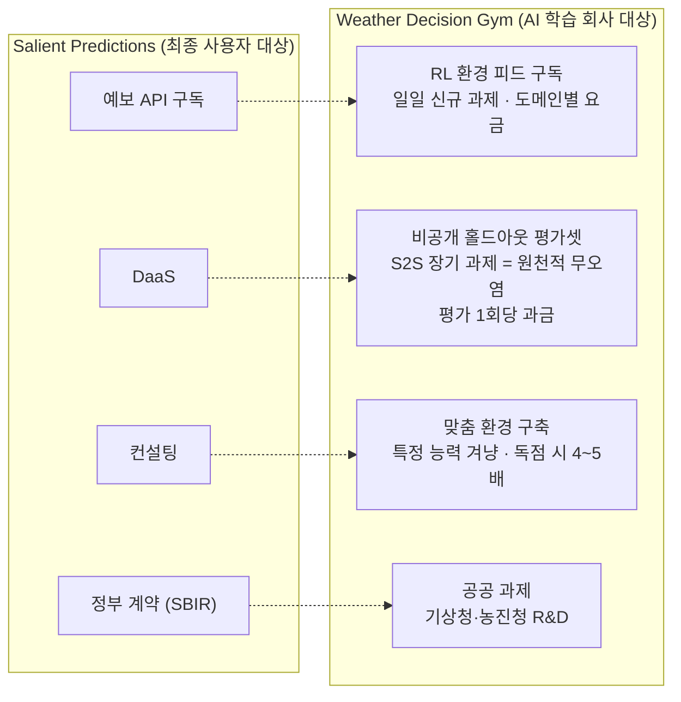

| 수익원 | 가격 가정 (발표 전 조정 필요) | 근거 |
|---|---|---|
| 환경 피드 구독 | 비독점 과제 묶음, 과제당 $50~$300 상당 볼륨 할인 | 업계 과제 단가 $200~$2,000 (Epoch). 우리는 자동 생성이라 한계비용이 매우 낮아 하단 가격 + 대량 공급 |
| 홀드아웃 평가 | 평가 런당 과금 또는 분기 라이선스 | 오염 불가능한 평가셋은 희소함 |
| 맞춤 환경 | 프로젝트당 6자리 $ | 계약 규모 "분기당 6~7자리 $", 독점 4~5배 (Epoch) |
| 공공 | 과제 단위 | Salient의 NOAA SBIR 사례 |

**단위 경제의 핵심:** Mercor형은 매출의 60~70%가 사람에게 나감. 우리는 **정답 라벨을 자연(날씨)이 무료로 제공**하므로, 원가 = 컴퓨팅 + 소수 도메인 전문가의 손실 함수 설계·검수뿐.

---

## 8. Moat

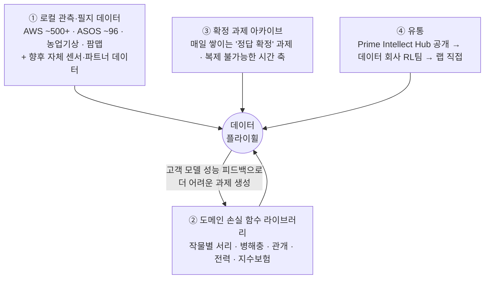

- 범용 RL 환경 회사(Mechanize, Prime Intellect): 날씨 도메인·로컬 관측 없음
- Lightning Rod: 사건 기반 → 확정 빈도·정밀도 낮음
- 기상 회사(Salient, Tomorrow.io, Jua): 최종 사용자 대상 판매, AI 학습 데이터 판매 안 함
- **시간은 복제할 수 없다**: 2026년 10월에 발행·확정된 과제 아카이브는 나중에 시작한 경쟁자가 만들 수 없다(백테스트로 흉내는 가능하지만 "당시 공개 정보만" 보장하는 스냅샷이 필요).

---

## 9. Go-To-Market

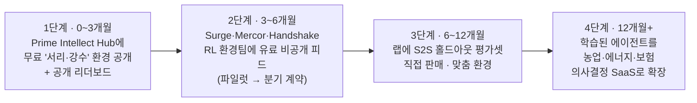

---

## 10. 해커톤 데모 계획

### 10-1. 데모 아키텍처

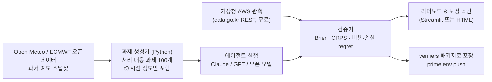

### 10-2. 데모에서 보여줄 3가지 "와우 포인트"
1. **자동 생성**: 버튼 한 번에 실제 지점·날짜 기준 과제 100개 생성 (사람 라벨 0)
2. **자동 채점**: 과거 관측으로 즉시 채점 → 모델별 Brier / regret(만 원) 리더보드
3. **납품 가능**: Prime Intellect `verifiers` 형식으로 패키징 — "오늘 바로 Surge에 보낼 수 있다"

### 10-3. 일정 (예시)

```mermaid
gantt
    title 해커톤 당일 빌드 일정 (예시)
    dateFormat HH:mm
    axisFormat %H:%M
    section 데이터
    오픈 예보·AWS 관측 수집          :a1, 10:00, 90m
    과제 생성기 (서리 과제)           :a2, after a1, 90m
    section 채점
    Brier · 비용-손실 검증기          :b1, after a1, 120m
    section 에이전트
    LLM 2~3종 실행                   :c1, after a2, 60m
    section 발표
    리더보드 · 보정 곡선 UI           :d1, after c1, 60m
    피치 덱 · 리허설                  :d2, after d1, 60m
```

---

## 11. 리스크 & 대응

| 리스크 | 대응 |
|---|---|
| "랩들이 직접 만들면 끝 아니냐" | 랩도 외부 공급사를 씀(Anthropic은 약 12개 공급사 보도). 도메인 손실 함수와 로컬 관측은 랩의 핵심 역량이 아님 |
| 정보 누출 (에이전트가 미래 관측을 검색) | 과제는 t0 스냅샷 도구만 제공, 인터넷 차단 샌드박스, 실시간 발행 과제로 원천 차단 |
| 날씨 과제가 "너무 쉬움" (예보를 그대로 복사하면 정답) | 보상을 원천 예보 대비 **스킬 점수**(skill score)로 정의 → 예보 복사 = 0점. 다운스케일링·결정 손익에서만 점수 획득 |
| 한국 데이터만으론 미국 고객에 매력 약함 | 미국 NOAA ASOS/Mesonet + GEFS로 즉시 확장 가능(공개 데이터). 한국은 PoC·고밀도 관측 쇼케이스 |
| 라이선스 | ECMWF 출력물 CC-BY 4.0 (출처 표기), AIFS 모델 가중치는 별도 라이선스(CC-BY-SA 표기) 확인 필요. 기상청 공공데이터 이용조건 확인 |
| S2S 과제는 확정까지 수주 | 오히려 장점: 평가셋 = 구조적으로 오염 불가능. 학습용은 단기 과제, 평가용은 장기 과제로 분리 |

---

## 12. Team / Ask

- **Team**: _(팀원 역할 채우기 — 기상/농학 도메인, ML/RL 엔지니어, BD)_
- **Ask (해커톤 이후)**: Surge·Mercor·Handshake RL 환경팀 파일럿 소개 / 오픈 환경 공개를 위한 컴퓨팅 크레딧 / 기상·농학 박사 자문단

---

## Appendix A. 용어 정리

| 용어 | 뜻 |
|---|---|
| RL 환경 (RL environment) | 과제 데이터셋 + 모델 실행 하네스 + 보상 함수/루브릭을 묶은 패키지 (Prime Intellect 정의) |
| RLVR | 검증 가능한 보상을 이용한 강화학습 (Reinforcement Learning with Verifiable Rewards) |
| Brier score | 이진 사건 확률 예측의 평균 제곱 오차. 낮을수록 좋음 |
| CRPS | 연속 변수(기온 등) 확률 예측 점수. 앙상블 예보 평가 표준 |
| 보정 (calibration) | "70%라고 말한 사건이 실제로 70% 일어나는가" |
| 비용-손실 모델 | 보호 비용 C와 피해 손실 L이 있을 때, 사건 확률 p > C/L이면 보호하는 것이 최적이라는 의사결정 모델 |
| 스킬 점수 (skill score) | 기준 예보(원천 예보, 기후값) 대비 얼마나 나아졌는가 |
| S2S | 아계절~계절(Subseasonal-to-Seasonal), 2주~수개월 리드타임 |
| 홀드아웃 평가셋 | 학습에 쓰지 않고 평가만을 위해 비공개로 유지하는 데이터 |

## Appendix B. 데이터 소스

| 소스 | 내용 | 비용·라이선스 |
|---|---|---|
| ECMWF Open Data (IFS, AIFS Single/ENS) | 전 지구 예보, 2025.10부터 원 해상도 전면 개방 | 무료, CC-BY 4.0 (출처 표기) |
| NOAA GFS / GEFS | 미국 전 지구 예보·앙상블 | 무료, 퍼블릭 도메인 |
| 기상청 지상(방재, AWS) 관측 조회서비스 | 전국 500여 지점, REST(JSON/XML), 지점번호+시각 조회 | 무료 (개발계정 10,000건) |
| 기상청 ASOS | 약 96 지점, 예보·기후 통계용 | 무료 |
| 농업날씨365 (농진청) | 약 211 지점 자동관측 | 무료 |
| WeatherBench 2 | AI 기상 모델 평가 프레임워크·기준 데이터 | 오픈소스 |
| Prime Intellect verifiers | RL 환경 패키징 라이브러리 (v0.1.14, 2026.5, v1 Taskset/Harness API) | 오픈소스 |

> 지점 수는 시점·출처마다 다릅니다(AWS 500여~600개). 발표 전 기상자료개방포털 지점정보에서 최신 값을 확인하세요.

## Appendix C. 수치 신뢰도 메모

- Mercor·Surge·Handshake 수치는 **비공개 기업에 대한 2차 출처 추정치**이며 총매출(gross)과 순매출(net)이 섞여 있음.
- Anthropic "$1B+"는 **지출을 "논의했다"는 보도**(The Information, 2025.9)이지 확정 지출이 아님.
- Salient 누적 투자액은 출처별로 상이($9.6M / $11.8M). 2026년 라운드는 확인되지 않음.
- Fengwu·Jua·Lightning Rod의 성능 주장은 **자사 발표 기준**.
- 포지셔닝 맵·보상 원천 비교 차트의 좌표는 **팀 정성 평가**이지 측정값이 아님.
- ClimateAi, Excarta는 이번 리서치에서 최신 정보를 확인하지 못함.

## Sources

**RL 환경·데이터 시장**
- [Epoch AI — An FAQ on reinforcement learning environments](https://epoch.ai/gradient-updates/state-of-rl-envs)
- [AIM — How Much Do Complex RL Tasks Really Cost?](https://analyticsindiamag.com/ai-news-updates/complex-reinforcement-learning-tasks-can-cost-up-to-20000-each-epochai-report)
- [Occludo — Anthropic reportedly spending $1B+ on RL environments](https://www.occludo.ai/articles/anthropic-is-reportedly-spending-1b-a-year-on-rl-environments-across-a-dozen-vendors)
- [TechCrunch — Silicon Valley bets big on environments](https://techcrunch.com/2025/09/21/silicon-valley-bets-big-on-environments-to-train-ai-agents/)
- [Sapphire Ventures — RL environments](https://sapphireventures.com/blog/reinforcement-learning-environments-ai-agents/)
- [SuperAnnotate — RL Environments](https://www.superannotate.com/blog/rl-environments)
- [Synaptic — RL environment startups](https://synaptic.com/resources/tip-offs/rl-evironments-startups-and-founders)
- [Towards AI — Why RL environments became 2026's bottleneck](https://pub.towardsai.net/why-rl-environments-became-ais-hottest-bottleneck-in-2026-0eec9c15e1bf)
- [Dealroom — Mercor $2B run rate](https://dealroom.co/news/137121-mercor-doubles-to-2b-gross-revenue-run-rate-as-ai-labs-buy-expert-data/)
- [StartupFortune — Mercor revenue](https://startupfortune.com/mercors-revenue-hit-2-billion-in-june-and-the-ai-data-race-isnt-slowing/)
- [Sacra — Handshake](https://sacra.com/research/handshake-indeed-for-data-labelers/) · [Sacra — Mercor](https://sacra.com/c/mercor/)
- [HeroHunt — Mercor vs Surge vs Scale 2026](https://www.herohunt.ai/blog/mercor-vs-surge-vs-scale-ai-2026-buyer-guide/)
- [Prime Intellect — verifiers docs](https://docs.primeintellect.ai/verifiers) · [GitHub — verifiers](https://github.com/PrimeIntellect-ai/verifiers)

**예측 RL·벤치마크**
- [arXiv — Outcome-based Reinforcement Learning to Predict the Future](https://arxiv.org/abs/2505.17989v2)
- [arXiv — Future-as-Label / Foresight Learning](https://arxiv.org/html/2601.06336v2)
- [arXiv — What LLM Forecasters Know but Don't Say](https://arxiv.org/pdf/2607.08046)
- [ICLR 2026 — Prophet Arena](https://iclr.cc/virtual/2026/poster/10009102) · [arXiv — Prophet Arena](https://arxiv.org/pdf/2510.17638v2)
- [FRI — ForecastBench](https://forecastingresearch.substack.com/p/ai-llm-forecasting-model-forecastbench-benchmark)
- [Hugging Face — Lightning Rod Foresight-32B](https://huggingface.co/LightningRodLabs/foresight-32B/blob/main/README.md) · [Longterm Wiki — Lightning Rod Labs](https://www.longtermwiki.com/wiki/lightning-rod-labs)

**기상 AI**
- [ECMWF — fully open data in 2025](https://www.ecmwf.int/node/29328) · [ECMWF Open Data](https://ecmwf.int/en/forecasts/datasets/open-data) · [ECMWF Newsletter 181 — AIFS ensemble](https://www.ecmwf.int/en/newsletter/181/earth-system-science/data-driven-ensemble-forecasting-aifs)
- [arXiv — Probabilistic measures for AIWP vs NWP](https://arxiv.org/pdf/2506.03744)
- [CB Insights — Salient](https://www.cbinsights.com/company/salient) · [Caplight — Salient](https://www.caplight.com/company/salientpredictions) · [Coverager — Salient seed](https://coverager.com/salient-predictions-raises-5-4-million/) · [Informed Infrastructure — Salient](https://informedinfrastructure.com/?p=89802)
- [BuiltIn — Tomorrow.io Series F](https://www.builtinboston.com/articles/tomorrowio-series-f-extension-210m-20260520) · [Tomorrow.io — DeepSky](https://www.tomorrow.io/?p=12251)
- [TechCrunch — WindBorne](https://techcrunch.com/2026/08/05/ai-makes-weather-prediction-better-can-windborne-make-it-lucrative/?type=AI)
- [Techleap — Silurian](https://finder.techleap.nl/news/feed/silurian-raises-6m-for-ai-driven-weather-forecasting-foundation-models)
- [Tech.eu — Jua $11M](https://tech.eu/2025/06/04/jua-raises-11m-to-scale-earth-simulation-platform-for-energy-and-climate-forecasting/)
- [The Next Web — China AI weather](https://thenextweb.com/news/china-ai-weather-forecasting-extreme-weather) · [TechRepublic — Fengwu](https://www.techrepublic.com/de/article/news-china-ai-weather-forecasting-fengwu-typhoon-apac/)

**한국 데이터**
- [공공데이터포털 — 기상청 지상(방재, AWS) 관측자료 조회서비스](https://www.data.go.kr/data/15057084/openapi.do)
- [KoreaScience — 관측망 지점 수 (2023)](https://koreascience.or.kr/article/JAKO202322357118785.pdf)
- [기상자료개방포털](https://data.kma.go.kr/data/rmt/rmtList.do?code=320)
